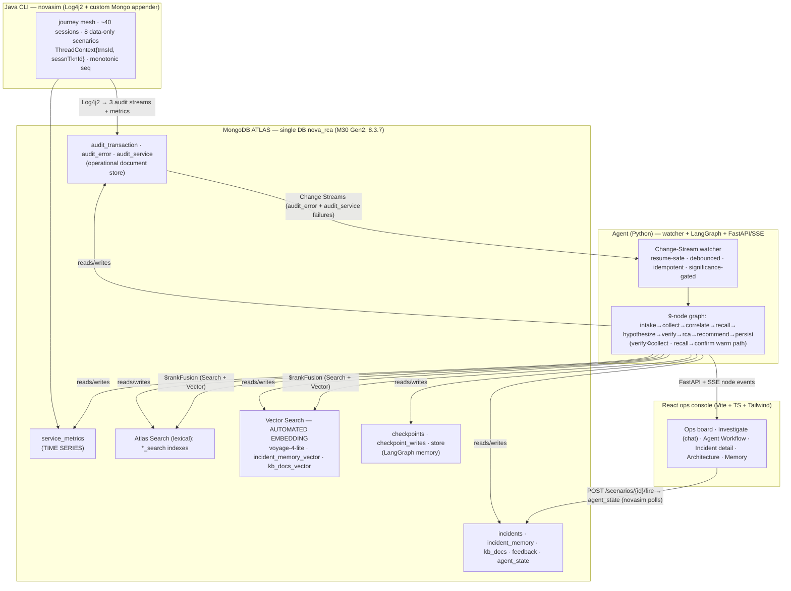

# NOVA 2.0 RCA — MongoDB Atlas as the Unified Data Platform for Agentic AI

A live demo that proves a single **MongoDB Atlas** database can serve *every* workload an
autonomous root-cause-analysis (RCA) agent needs — operational document store, Change Streams
event bus, time-series metrics, Atlas Search (lexical), Vector Search with **Automated Embedding**,
`$rankFusion` hybrid retrieval, and durable **LangGraph** agent memory — with **zero bolt-ons**.

A Java CLI simulates the NOVA 2.0 banking super-app's journey mesh and writes real-shaped audit
logs to Atlas. **Change Streams wake a LangGraph agent** that performs cross-collection RCA and
publishes a report. A React ops console shows the agent *think*, node by node. The loud error is
never the origin — the whole point is cross-collection correlation.

> This is **not** a chatbot over logs. There is no chat box. The agent runs autonomously and
> publishes a structured incident.

---

## The 90-second narrative

1. A live ops board shows NOVA journeys ticking over; downstream tiles (EIS, UNIPAY, Martech,
   THINK360) green; latency sparklines flowing from the time-series collection.
2. In the Java CLI, the presenter types `fire eis-martech-brownout`.
3. Within seconds the Martech tile ambers, `eis_marTech_getInteractOffers` latency climbs from
   ~300ms toward ~10s, `TEEIS009 Response Transformation failed` counts tick up, and offer-fetch
   errors surface across many sessions.
4. **An incident card appears by itself** — Change Streams, nobody clicked anything.
5. The agent workflow lights up: `intake → collect → correlate → recall → hypothesize → verify →
   rca → recommend → persist`. `recall` reports *"no similar prior incidents."*
6. The RCA lands: the user-facing failures across N sessions are **symptoms**; the **origin** is the
   shared EIS `thirdParty/wrapper/Martech` route — with the exact audit documents cited, clickable.
7. Fire the same scenario again. `recall` **hits** — the agent short-circuits to a confident RCA in
   a fraction of the time, cites the first incident, and the memory panel shows the playbook hit
   count at 2.

---

## Quick start

**Prerequisites:** a `.env` at the repo root (copy `.env.example`) with `MONGODB_URI`, `GROVE_*`,
and `ATLAS_*`; Java 21 + Maven on PATH for the simulator; Node 22 for the UI. Atlas collections and
indexes are already provisioned (`make atlas-provision` re-verifies them, idempotent).

```bash
make reset      # clean board: clears incidents/memory/store/checkpoints + audit, reseeds kb_docs
make up         # agent (:8000) + UI (:5173), waits for /api/health
make sim        # interactive simulator — then type: fire eis-martech-brownout
```

Open **http://localhost:5173**. See `docs/DEMO.md` for the full 5-minute core script and the
15-minute architect deep-dive.

```
make up             # agent + UI (local venv + Vite; Atlas is cloud)
make sim            # interactive simulator (status | scenarios | fire <id> | quit)
make reset          # clean board + reseed kb
make demo           # up + open the ops board
make test           # unit tests + shape validation + no-embed guardrail
make eval           # live 8-scenario RCA eval (needs Atlas + Grove; >=7/8)
make replay         # offline fallback: replay a recorded run, networking disabled
make down           # stop agent + UI
make atlas-provision# verify collections + search/vector indexes (idempotent)
```

---

## Architecture



**There is no embedding client anywhere in `/agent`.** `recall` and `persist` pass raw text; Atlas
Automated Embedding (`voyage-4-lite`) vectorizes it at write and query time inside the database.
`make check-no-embed` enforces this as a guardrail.

### Components

| Layer | Tech | Role |
|---|---|---|
| **Log generator** | Java 21, Maven, picocli, Log4j2 + custom `@Plugin` Mongo appender (driver 5.x) | Simulates ~40 sessions across ~15 journeys and their EIS/UNIPAY/Martech/THINK360 downstream calls; 8 failure scenarios as generic effect interpreters (no scenario names in emitted data) |
| **Database** | MongoDB Atlas M30 Gen2, MongoDB 8.3.7 | One DB `nova_rca` — every workload below |
| **Embeddings** | Atlas Vector Search **Automated Embedding**, `voyage-4-lite` | `autoEmbed` index type; query with `$vectorSearch: {query:{text:…}}`, never a `queryVector`, never an embedding API call |
| **LLM** | Grove (OpenAI-compatible gateway), `gpt-5.4-mini` | Structured-output ladder `json_schema → json_object → prompt+retry`; deterministic nodes do the analysis, the LLM narrates and ranks |
| **Agent** | Python 3.12, LangGraph, `langgraph-checkpoint-mongodb`, `langgraph-store-mongodb`, PyMongo | Change-stream watcher + 9-node RCA graph + native memory |
| **API** | FastAPI + SSE | Node-level event stream + REST |
| **UI** | React 18 + Vite 5 + TypeScript + Tailwind (no chart libraries — hand-rolled SVG) | Six live views: Ops board, **Investigate (chat + screenshot → RCA)**, Agent Workflow, Incident detail, **Architecture (apps · ingestion rates · query latencies)**, Memory |

### The agent graph (9 nodes)

`intake → collect → correlate → recall → hypothesize → verify → rca → recommend → persist`, with
`verify ⟲ collect` (widen the window once if all hypotheses score < 0.34) and a `recall → confirm`
**warm short-circuit** (a confident memory hit skips the LLM path and confirms a recurrence
deterministically — run #2 is measurably faster).

| Node | Kind | Does | Capability badge on screen |
|---|---|---|---|
| intake | code | normalize trigger(s), open the incident, `thread_id = incidentKey` | **Change Streams** |
| collect | code | widening ladder: trns → session → same cmnd/srvc ±window → time-series baseline | **Time Series** |
| correlate | code | order by `(strt_time, seq)`; decode transport **and** business status; unwrap nested `err_dtls`; **origin = earliest downstream failure, distinct from loudest** | **layered-status decode** |
| recall | memory | two `$rankFusion` aggregations (incident_memory, kb_docs), each fusing a `$vectorSearch` (autoEmbed) arm + a `$search` lexical arm; read the route playbook | **$rankFusion — Atlas Search + Vector Search (autoEmbed voyage-4-lite)** |
| hypothesize | LLM | 2–4 candidate causes, each citing real `_id`s (uncited discarded) | reasoning LLM |
| verify | code | turn each hypothesis into a **real MongoDB aggregation** (incidence, latency regression, ops precursor); score; may loop to collect once | evidence check |
| rca | LLM | causal chain, evidence subset, confidence, honest unknowns | reasoning LLM |
| recommend | LLM | three tiers (immediate / fix / prevention) with owner, effort, impact | tiered actions |
| persist | code | write the incident; distill `summary_text` → incident_memory (**text only**); upsert playbook | **Automated Embedding — no client code** |
| confirm | code | *warm path:* reuse the recalled incident + playbook to confirm a recurrence with no LLM | Agent memory — recurrence confirmed |

### Data model (single DB `nova_rca`)

- **Operational** — `audit_transaction`, `audit_error`, `audit_service`: one document per API call /
  error / downstream call, joined on `trns_id` (primary key) and `sessn_tkn_id`. Authentic quirks
  preserved: spelling drift `trns_stts`/`trns_sts`, `' UNIPAY'` leading space, `'NULL'` literals,
  double-encoded JSON payloads, mixed int/str status vocabularies.
- **Time series** — `service_metrics` (`timeField: ts`, `metaField: meta{service,system,kind,route}`):
  powers ops-board sparklines and the agent's p95 baseline-vs-incident check.
- **Atlas Search** — `audit_error_search`, `audit_service_search`, `incident_memory_search`,
  `kb_docs_search` (lexical); `incident_memory_vector`, `kb_docs_vector` (`autoEmbed`, `voyage-4-lite`).
- **Agent memory** — `checkpoints` + `checkpoint_writes` (LangGraph `MongoDBSaver`), `store`
  (`MongoDBStore` route playbooks).
- **Agent output** — `incidents` (the RCA report), `incident_memory` (distilled, auto-embedded),
  `kb_docs` (seeded runbooks), `feedback` (the learn path), `agent_state` (resume tokens, heartbeat,
  sim command).

Index definitions live in `atlas/index_defs/*.json`; `atlas/indexes.py` provisions everything
idempotently. Because **Change Streams are not supported on time-series collections**, the triggers
sit on the audit collections and `service_metrics` is read-side only.

---

## What it proves (six claims → on-screen proof)

| # | Claim | Proof |
|---|---|---|
| 1 | **One platform, six workloads** | Architecture slide has one datastore; each capability is named on the workflow node the moment it fires (badges). |
| 2 | **Change Streams are the event backbone** | Fire in the CLI → the incident card appears and the agent starts, unprompted, within seconds. |
| 3 | **Agent memory is native + Automated Embedding** | Fire twice: run #2 is faster, higher-confidence, cites run #1; `grep -r embed agent/` finds no embedding client. |
| 4 | **Hybrid retrieval done right** | The recall inspector shows both arms (`$search` for exact codes like `TEEIS009`, `$vectorSearch` for semantics) and the `$rankFusion` fused ranking + the literal pipeline. |
| 5 | **Cross-collection correlation beats single-log analysis** | Every RCA names an origin that is **not** the service that screamed; swimlanes flag the exact ORIGIN document distinct from symptoms; the **Agent queries** panel lists every MongoDB query the investigation fired — correlation joins, the **time-series** `$percentile` baseline, hybrid `$rankFusion` recall, verify aggregations — expandable, in execution order, with workload badges. Evidence citations click through to the full audit document. |
| 6 | **The workflow is legible** | The DAG lights node by node; each node's input/output and (recall/verify) the actual aggregation pipeline are inspectable. |

### Investigate — ask the agent (chat + screenshot)

- The **INVESTIGATE** tab is a multi-turn chat: describe a customer issue ("offers are failing"),
  optionally attach a screenshot, and a **vision LLM** triages it into signals (journeys, error codes,
  ids, timeframe). A deterministic ladder then searches `audit_transaction` / `audit_error` /
  `audit_service` for evidence: explicit ids → error codes → errored journey transactions → Atlas
  Search over the error text (only when no structured signal exists).
- If a recent incident already covers the evidence, the agent cites it; otherwise it launches the
  **same 9-node RCA graph** (`chat-…` incident key), streams progress in the chat, and replies with the
  RCA (fault class, origin, confidence, top action). Follow-up questions ("who was affected?") are
  answered from the linked incident. No match → an honest "no matching failures + what I monitor".
- Chat history is stored in Atlas (`chat_sessions`; screenshots in `chat_images`, 7-day TTL) — the
  support conversation itself is on the same one platform.

### Architecture page — apps, rates, latencies

- The **ARCHITECTURE** tab shows the simulated Java applications (NOVA App journey tier, EIS Gateway,
  UNIPAY BBPS, Metrics emitter) as live cards: writes→collections, **ingestion docs/s** (60 s window),
  last write, error counts — plus a flow diagram (apps → Log4j2 → one Atlas DB → Change Streams →
  agent → SSE → console) with live numbers.
- The collections table lists every collection with docs, size, ingest rate and a **live sampled query
  latency** (a timed indexed `find_one` per 5 s poll). A "Correlation · live" panel shows the newest
  `trns_id` written independently by multiple services — the join the agent performs in `collect`.

### Scenario context, fault classification & collections

- **Every scenario explains itself on screen.** The Ops board scenario list is an expandable catalog:
  each entry shows a **fault-class badge** (technical / business), a description, the *expected origin*,
  the *loud decoy* it must see past, and the **collections it analyzes**. Metadata lives in
  `novasim/src/main/resources/scenarios/<id>.json` and is served by `GET /api/scenarios` (the agent
  never reads it — guardrail intact).
- **Technical vs business RCA.** The agent classifies each root cause as **technical** (transformation,
  timeout, credential/token, connection pool, malformed response) or **business** (rule / data /
  compliance) — a downstream technical failure is technical *even when the user sees a business code*.
  6 of the 8 scenarios are technical, 2 business; the incident card and detail show the class + reason.
- **Collections made concrete.** Each incident's detail view has a **Collections analyzed** panel —
  which of the one Atlas DB's collections the agent queried (`audit_transaction/error/service`,
  `service_metrics`, `incident_memory`, `kb_docs`, `store`) and how many docs each contributed.
- **The silent business failure is detectable.** `unipay-bbps-brownout` is transport-success /
  business-fail with no red status and no error doc; a payload-matching change-stream arm plus a
  hard-vs-burst significance gate let the agent wake for it while keeping benign single errors as noise.
- **Grounded in the sample.** The scenario error codes reproduce `Sample Log Data.xlsx` exactly
  (`TEEIS009`, `BS000001`→`BSYHP003`/`BSPAPL010`/`BSDML050`→`BSDML024`, `TEY2GSA02`, `5151`, UNIPAY
  transport-ok/business-fail); the workbook's `err_typ` (BUSINESS vs TECHNICAL) grounds the fault split.

---

## Repo layout

```
/novasim      Java CLI generator (Maven) — journey mesh, custom Log4j2 Mongo appender, 8 scenarios
/agent        LangGraph agent + change-stream watcher + FastAPI/SSE
  nova_agent/
    graph/      state.py, nodes.py (9 nodes), graph.py, runner.py, prompts/ (field glossary)
    memory/     checkpointer.py (MongoDBSaver), store.py (MongoDBStore), recall.py ($rankFusion)
    watcher/    change_stream.py (resume-safe), debounce.py
    api/        routes.py, sse.py, app.py
    llm.py, db.py, config.py, atlas_admin.py
  tests/        unit tests + eval_scenarios.py
  replay.py     offline record/serve fallback
/ui           React + Vite + TS + Tailwind ops console (4 views)
/atlas        indexes.py + index_defs/*.json (search + autoEmbed vector + TTL)
/data         Sample_Log_Data.xlsx, seed.py (repair rules), validate_shapes.py, reset.py, replay/
/docs         PLAN · DECISIONS · DEMO · ARCHITECTURE · SCHEMA · glossary · scenarios-ground-truth
docker-compose.yml   Makefile   .env.example
```

---

## Testing

```bash
make test    # 32 unit tests + shape validation + no-embed guardrail (no external services)
make eval    # 8-scenario RCA eval through the real graph (needs Atlas + Grove; passes at >=7/8)
```

- **Unit tests** (`agent/tests/`) cover the deterministic credibility core with no network:
  layered-status decode (UNIPAY `BFR003`, EIS 404-inside-success), nested `err_dtls` unwrap
  (`BSDML050 → BSDML024`), transport/business classification (int **and** string `trns_sts`), route
  derivation, debounce windows + escalation + significance sources, recall/verify routing, window
  parsing, and BSON-safe serialization.
- **Shape validation** (`data/validate_shapes.py`) asserts every audit document conforms to the
  contract — on both seeded and generated data.
- **Scenario eval** (`agent/tests/eval_scenarios.py`) drives all **8 scenario classes** through the
  real graph and checks the origin family is correct and never the loud decoy. Current result: **8/8**.

The 8 scenarios: `eis-martech-brownout`, `martech-cif-desync`, `think360-token-expiry`,
`unipay-bbps-brownout`, `gsa-validation-hang`, `demand-loan-improper-response`, `poison-retry-loop`,
`eis-gateway-pool-exhaustion`. Their ground truth (never seen by the agent) is in
`docs/scenarios-ground-truth.md`.

---

## Configuration (`.env`)

`MONGODB_URI`, `MONGODB_DB=nova_rca`, `GROVE_BASE_URL`, `GROVE_API_KEY`, `GROVE_MODEL=gpt-5.4-mini`,
`LLM_FAST_MODEL`, `LLM_REASONING_MODEL`, `LLM_VISION_MODEL=gpt-4o-mini` (screenshot triage),
`GROVE_STRUCTURED_MODE=json_schema`, `DEBOUNCE_WINDOW_SECONDS=4`, `COLLECT_WINDOW_SECONDS=120`,
`RECALL_MIN_VECTOR_SCORE=0.72`, `CHAT_LOOKBACK_MINUTES=30` (Investigate search window),
`AGENT_PORT=8000`, `UI_PORT=5173`, `REPLAY_MODE=0`, `ATLAS_PUB_KEY`, `ATLAS_PRIV_KEY`,
`ATLAS_GROUP_ID`, `ATLAS_CLUSTER`. See `.env.example`.

Any OpenAI-compatible endpoint works via the three `GROVE_*` / `LLM_*` vars (the role abstraction
makes the model swap config-only). Any Atlas M10+ cluster on MongoDB 8.1+ supports every feature.

---

## Resilience / offline fallback

- **`make replay`** serves a recorded run from `data/replay/` with networking disabled (no Atlas,
  no Grove) — the venue break-glass plan. Record a blessed run with `python agent/replay.py --record`.
- **Kill any component mid-demo:** the watcher resumes from its persisted change-stream token (no
  duplicates, no gaps), the UI reconnects SSE automatically, and novasim buffers writes through an
  Atlas blip. The React `ErrorBoundary` keeps the console alive if a single view errors.

---

## Guardrails

No hardcoded answers · no scenario names in emitted data (generic effect interpreters) · RCA cites
real doc `_id`s · origin must differ from the loudest error · **no embedding client in `/agent`**
(`make check-no-embed`).

---

## Further reading

- **`docs/DEMO.md`** — 5-minute core script + 15-minute architect deep-dive.
- **`docs/ARCHITECTURE.md`** — diagram, node table, claim→proof map, data flow.
- **`docs/DECISIONS.md`** — every non-obvious choice (one line each) + version pins + reality corrections.
- **`docs/PLAN.md`** — the phased execution plan and P0 spike results.
- **`docs/SCHEMA.md`** / **`docs/glossary.md`** — document shapes and the NOVA field vocabulary.
- **`docs/scenarios-ground-truth.md`** — the eval oracle (the agent never reads it).
