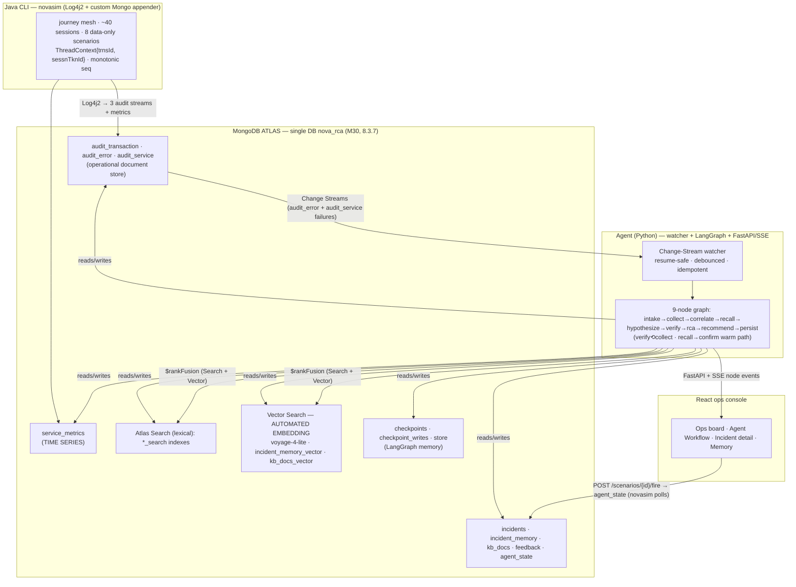

# ARCHITECTURE — NOVA 2.0 RCA on MongoDB Atlas

One datastore. One agent. The log-RCA use case proves **MongoDB Atlas is the unified data platform for
agentic AI**.

## System diagram

The agent contains **no embedding client**. `recall` and `persist` pass raw text; Atlas Automated
Embedding (`voyage-4-lite`) vectorizes it at write and query time inside the database.

## The nine nodes

| Node | Kind | Does | Capability badge on screen |
|---|---|---|---|
| intake | code | normalize trigger, open the incident, `thread_id = incidentKey` | **Change Streams** |
| collect | code | widening ladder: trns → session → same cmnd/srvc ±window → TS baseline | **Time Series** |
| correlate | code | merge + order by `(strt_time, seq)`; decode transport **and** business status; unwrap nested `err_dtls`; **origin = earliest downstream failure, distinct from loudest** | **layered-status decode** |
| recall | memory | two `$rankFusion` aggregations (incident_memory, kb_docs), each fusing `$vectorSearch` (autoEmbed) + `$search` lexical; read playbook | **$rankFusion — Atlas Search + Vector Search (autoEmbed voyage-4-lite)** |
| hypothesize | LLM | 2–4 candidate causes, each citing real `_id`s (uncited discarded) | reasoning LLM |
| verify | code | turn each hypothesis into a **real MongoDB aggregation** (incidence, latency regression, ops precursor); score; may loop to collect once | evidence check |
| rca | LLM | causal chain, evidence subset, confidence, honest unknowns | reasoning LLM |
| recommend | LLM | three tiers (immediate / fix / prevention) with owner, effort, impact | tiered actions |
| persist | code | write incident (§3 contract); distill `summary_text` → incident_memory (**text only**); upsert playbook | **Automated Embedding — no client code** |
| confirm | code | *warm path:* reuse recalled incident + playbook to confirm a recurrence with no LLM | Agent memory — recurrence confirmed |

## The six claims → on-screen proof

| # | Claim | Proven on screen | Verified |
|---|---|---|---|
| 1 | **One platform, six workloads.** Document store, Change Streams, time series, Atlas Search, Vector Search (Automated Embedding), agent memory — all Atlas. | Architecture slide has exactly one datastore; each capability is named on the workflow node the moment it fires (badges). | ✅ badges fire per node in live SSE |
| 2 | **Change Streams are the event backbone.** The agent wakes because data changed, not on a poll. | Fire in the CLI → within seconds the incident card appears and the workflow starts, unprompted. | ✅ inserting a cascade (no API call) produced an autonomous incident |
| 3 | **Agent memory is native + Automated Embedding.** LangGraph checkpointer + store in Atlas; past incidents recalled by vector search; app never calls an embedding API. | Fire twice: run-2 is faster, higher-confidence, cites run-1; playbook hit count = 2. `grep -r embed agent/` finds nothing. | ✅ 5.4× faster (3.3s vs 17.7s), conf 0.9>0.8, cites run-1, seenCount 2 |
| 4 | **Hybrid retrieval done right.** Exact codes (`TEEIS009`) are lexical; "downstream transformation failures" is semantic; `$rankFusion` combines them. | The recall inspector shows both arms and the fused ranking + the literal pipeline. | ✅ vector top≈0.51, lexical exact, fused RRF≈0.03 all render |
| 5 | **Cross-collection correlation beats single-log analysis.** Three audit collections joined on `trns_id`/`sessn_tkn_id`; the loudest error is never the origin. | Every RCA names an origin that is not the service that screamed; swimlanes flag ORIGIN distinct from symptoms. | ✅ origin `eis_marTech_getInteractOffers` vs loudest `BS000001` |
| 6 | **The workflow is legible.** The audience watches the agent think, not a spinner. | The DAG lights node by node; each node's input/output and (recall/verify) the actual aggregation pipeline are inspectable. | ✅ live node lifecycle + literal `$rankFusion`/verify pipelines in inspector |

## Data model (single DB `nova_rca`)
- **Operational:** `audit_transaction`, `audit_error`, `audit_service` — one document per API call / error /
  downstream call; joined on `trns_id` (primary key) and `sessn_tkn_id`. Intentional quirks preserved:
  spelling drift `trns_stts`/`trns_sts`, `' UNIPAY'` leading space, `'NULL'` literals, double-encoded
  payloads.
- **Time series:** `service_metrics` (`timeField:ts`, `metaField:meta{service,system,kind,route}`) — powers
  ops-board sparklines and the agent's p95 baseline-vs-incident check.
- **Search:** `audit_error_search`, `audit_service_search`, `incident_memory_search`, `kb_docs_search`
  (lexical); `incident_memory_vector`, `kb_docs_vector` (`autoEmbed`, `voyage-4-lite`).
- **Agent memory:** `checkpoints` + `checkpoint_writes` (MongoDBSaver), `store` (MongoDBStore playbooks).
- **Agent output:** `incidents` (RCA report), `incident_memory` (distilled, auto-embedded), `kb_docs`
  (seeded runbooks), `feedback` (learn path), `agent_state` (resume tokens, heartbeat, sim command).

## Request/event flow
1. novasim writes audit + metric docs via the Log4j2 appender.
2. Change Streams on `audit_error` + `audit_service` failures feed a debounce buffer; a closed window
   claims one incident idempotently and dispatches the graph.
3. The graph streams node events over SSE; the UI renders the DAG, incident, and memory live.
4. `persist` writes the incident and a text-only `incident_memory` doc; Atlas auto-embeds it, so the next
   identical incident is recalled by `$rankFusion` and short-circuits.
